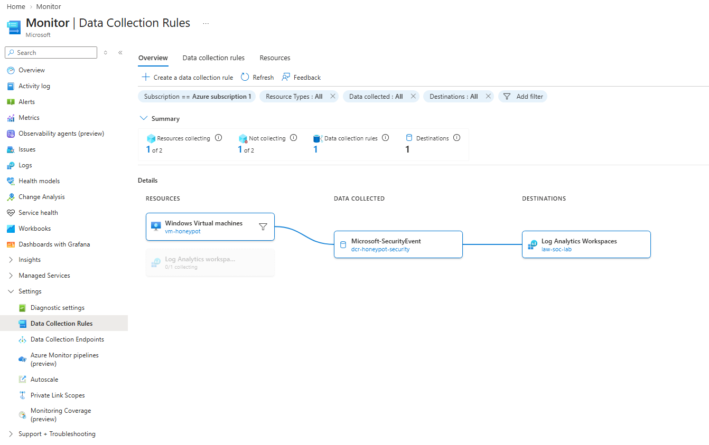

# Microsoft Sentinel Honeypot Lab: detecting RDP brute-force attacks in Azure

A hands-on SOC lab built as a junior learning project. I exposed a Windows Server VM to the internet on purpose, sent its security logs to Microsoft Sentinel, and built detections, incidents and an attack map from real traffic.

**Result:** about 4,461 failed RDP logons from 7 countries during roughly 2 days of log collection, and no successful external logon in the data collected.

## Objective

Practise the core SOC workflow end to end: collect logs, investigate with KQL, write a detection rule, work an incident, and visualise the findings. The lab was designed to cost close to nothing and to be deleted afterwards.

## Architecture

```
Internet -> vm-honeypot -> Azure Monitor Agent + DCR -> Log Analytics workspace -> Microsoft Sentinel -> Defender portal
```

| Component | Purpose |
|---|---|
| `vm-honeypot` | Windows Server 2022 with RDP (3389) open on purpose (East US 2) |
| Azure Monitor Agent (AMA) | Runs on the VM and ships Windows Security Events |
| Data Collection Rule (DCR) | Defines which events to collect and from which machine |
| Log Analytics workspace | Stores the logs, queried with KQL |
| Microsoft Sentinel | The SIEM: analytics rules, incidents, workbooks |
| `rg-soc-lab` | One resource group for everything, so a single delete cleans it up |

The pipeline as seen in Azure Monitor (VM, data collection rule, workspace):



## Tools and skills

Azure, Microsoft Sentinel, Microsoft Defender portal, Log Analytics, Azure Monitor Agent, KQL, Windows Security Events, MITRE ATT&CK, Azure Cloud Shell (CLI), Workbooks.

## What I built

1. **Foundation:** Azure account, budget alert, MFA, resource group.
2. **SIEM:** Log Analytics workspace with Microsoft Sentinel enabled and connected to the Defender portal.
3. **Honeypot VM:** Windows Server 2022 with a non-default username and a long unique password, auto-shutdown configured, nothing personal stored on it.
4. **Log ingestion:** installed the *Windows Security Events* solution from the Content hub and created a DCR (`dcr-honeypot-security`) collecting all security events.
5. **Investigation:** KQL queries on failed logons (Event ID 4625), successful logons (4624) and attacker behaviour.
6. **Detection:** a scheduled analytics rule that creates incidents for brute-force activity.
7. **Visualisation:** a workbook with an attack map and a table of attempts per country.

### Log ingestion

Data connector with the data collection rule `dcr-honeypot-security`:


First events arriving in the `SecurityEvent` table:


Breakdown of the events collected in 24 hours:


## Key Windows events

| Event ID | Meaning |
|---|---|
| 4624 | Successful logon (Logon Type 10 = RDP) |
| 4625 | Failed logon, the brute-force signal |
| 4672 | Special privileges assigned |
| 4688 | Process creation |

## Detection rule

- **Name:** RDP brute force - multiple failed logons from one IP
- **MITRE ATT&CK:** Credential Access, T1110 Brute Force (T1110.001 Password Guessing, T1110.003 Password Spraying)
- **Schedule:** runs every 5 minutes over the last 5 minutes (lookback equals frequency, so there are no coverage gaps)
- **Entity mapping:** IP address
- **Incident grouping:** alerts grouped by IP within 24 hours

```kusto
SecurityEvent
| where EventID == 4625
| where IpAddress !in ("-", "")
| summarize Attempts = count(),
            Accounts = dcount(TargetUserName),
            UserList = make_set(TargetUserName),
            FirstAttempt = min(TimeGenerated),
            LastAttempt = max(TimeGenerated) by IpAddress
| where Attempts >= 5
```

**Known limitation:** a threshold of 5 failures in 5 minutes catches fast, aggressive sources but can miss slower attackers. The threshold was chosen for fast alerting.

Rule configuration (review screen):


## Investigation queries

Failed logons by country (also used in the workbook):

```kusto
SecurityEvent
| where EventID == 4625 and IpAddress !in ("-", "")
| extend Geo = geo_info_from_ip_address(IpAddress)
| summarize Attempts = count() by Country = tostring(Geo.country)
| sort by Attempts desc
```

Check whether any external source logged in successfully:

```kusto
SecurityEvent
| where TimeGenerated > ago(7d)
| where EventID == 4624
| where IpAddress !in ("-", "")
| project TimeGenerated, TargetUserName, IpAddress, LogonType
```

## Incident handling

An external source triggered the rule (IP and analyst name redacted). The incident was assigned and moved to *Active*:


My own test incident, closed with a classification and a written comment:


## Findings

| Country (by IP geolocation) | Failed logons |
|---|---|
| Russia | 2,759 |
| Brazil | 702 |
| Slovenia | 463 |
| United States | 300 |
| Iran | 233 |
| Germany | 2 |
| Romania | 2 |
| **Total** | **4,461** |


Sources by country over a 24-hour sample (IP addresses redacted):


- **Two attack styles:** one source rotated through about 260 different usernames (a dictionary or password-spraying pattern), while the others repeated a single default name.
- **Targeted usernames:** in a 24-hour sample, the most tried names were `azureuser` (1,118), `Administrator` (523) and `administrator` (381). These are default names, which is why choosing a non-obvious username matters.
- **No successful external logon** appeared in the collected data.
- Country is the geolocation of the source IP. It shows where traffic appeared to come from, not who the attacker is (VPNs, proxies and infected machines are common).

## Challenges and what I learned

| Problem | Cause | Fix |
|---|---|---|
| `NotAvailableForSubscription` when choosing a VM size | Size restrictions on a free-trial subscription in some regions | Changed region and upgraded to Pay-As-You-Go |
| Sizes with a "p" were rejected | Arm64 sizes cannot run an x64 Windows image | Chose an Intel x64 size (B2ls_v2) |
| `QuotaExceeded` | vCPU quota for the VM family was 0 | Submitted a quota request, approved by Microsoft Support |
| Quota portal showed no data | Session signed in to a different tenant | Signed in with the correct personal account |
| No data in the workspace | DCR was associated, but the Azure Monitor Agent was never installed on the VM | Assigned a managed identity and installed the agent with the Azure CLI, then verified with the `Heartbeat` table |
| KQL aggregation returned nothing | Grouping by IP and account split 3 attempts from 3 accounts into 3 groups of 1 | Grouped by IP only and counted distinct accounts with `dcount()` |
| 282 duplicate incidents | The rule fired on every run for a continuous attack, with no alert grouping | Enabled grouping by IP entity, matched lookback to frequency, closed duplicates in bulk |
| Budget alert never arrived although spend passed the limit | A typo in the alert recipient email address (two digits swapped) | Found it by reviewing the budget settings; corrected the address and now check recipients after creating any alert |

Evidence of the quota problem and its resolution:


**Main lessons**

- Verify that data actually arrives (`Heartbeat`, `SecurityEvent`), not just that the configuration looks right.
- Tuning a detection rule matters as much as writing it. Threshold, window and grouping are one decision.
- Check the time range of your data before claiming "nothing happened".

## Cost

The lab was designed to stay close to free: auto-shutdown on the VM, a single resource group so everything could be deleted at once, and a clean-up at the end.

| Resource | Cost (AUD) |
|---|---|
| Virtual machine (B2ls_v2, Bsv2 series) | 4.02 |
| Standard public IPv4 address | 2.54 |
| Standard SSD managed disk | 1.82 |
| Azure Monitor (small, not tied to a named resource) | 0.11 |
| Log Analytics workspace / Sentinel / bandwidth | ~0.00 |
| **Total** | **AU$8.49** |

- **Average: AU$0.43 per day.**
- **Amount due: 0.** All charges were covered by Azure free credits (276.53 remaining at the time, expiring 4 November 2026).
- Microsoft Sentinel and log ingestion were essentially free, consistent with the 31-day free trial.
- Cost data can lag by up to a day, so the final figure may change by a few cents.


**Lessons:** a public IP and a disk keep billing even when the VM is stopped, so deleting only the VM is not enough. The VM itself was about half of the total. A USD 5 monthly budget with alerts at 50% (forecast) and 100% (actual) was created on day one. Spend passed the limit (about USD 5.94), but the notification never reached me because of a typo in the recipient address. Lesson: a budget alert only notifies, it does not stop spending, and it is worth testing that the notification actually arrives.

## Security practices followed

MFA on the account, non-default username and long unique password, nothing sensitive on the VM, budget alert, network discovery left off, screenshots redacted before publishing, and the VM stopped and all resources deleted at the end.

## Limitations

- Sentinel only sees events from the moment the agent started sending logs. The VM's local Security log was not reviewed for the period before collection started, and the data covers only the time the VM was running and sending logs.
- All Security Events was collected for learning. A production setup would use a narrower collection level to control ingestion cost.
- Geolocation is approximate.

## Clean-up

Stopped the VM to end data collection, then deleted the `rg-soc-lab` resource group (VM, disk, public IP, network, workspace, Sentinel and workbook) so nothing keeps billing.

After deletion, the only resource left in the subscription is `NetworkWatcher_eastus2`, a free resource Azure creates automatically:


## Next steps

- Add a Logic App playbook to notify on new incidents.
- Add a rule for successful logons after multiple failures from the same IP.
- Study for CompTIA Security+ and SC-200.
